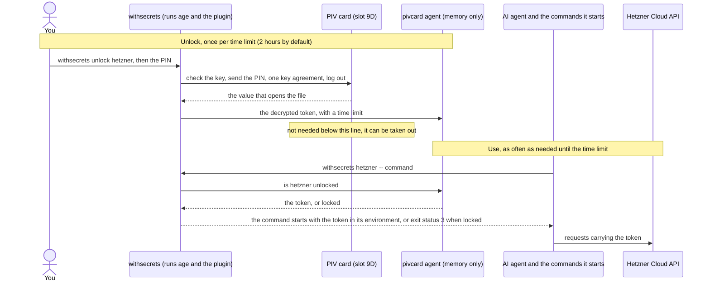
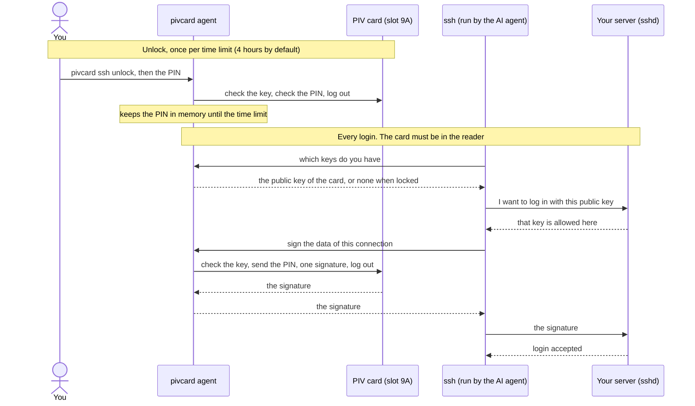

# PIV secrets for AI agents

**API keys and SSH keys for AI agent sessions, held behind a secure element.**

An AI coding agent that works in your terminal can read every file you can read. That includes the `.env`
file with your cloud API token and the private key in `~/.ssh`. A prompt injection in a web page, an issue
or a dependency is enough for a secret that sits in a file to be copied somewhere else.

This project puts the two credentials such a session needs most behind a PIV smart card. A PIV card is a
secure element: a chip that holds private keys, uses them when asked, and has no command to read them out.
The AI agent can use the SSH key, and can read the API token, while you allow it. It does not find either
of them in a file, and it is never told the card's PIN.

The repository contains:

- `age-plugin-pivcard`, a plugin that lets a standard PIV card (NIST SP 800-73) be the key for
  [age](https://age-encryption.org), an open-source file encryption tool. The API token is stored as an
  ordinary age file, so no new encryption format was invented here;
- **`withsecrets`**, which runs a command with secrets that only the card can decrypt;
- **`pivcard ssh`**, an SSH agent for a key that was generated on the card and cannot leave it;
- a complete worked example: [create a Hetzner Cloud server with the API token, and log in to it with the
  SSH key](#the-worked-example-a-hetzner-cloud-server).

It runs on Linux and Windows, and has been tested on both with real cards.

Two programs here are called "agent". This page always says which one it means: **the AI agent** is the
coding assistant, and **the pivcard agent** is a small background program of this project.

## How the two card slots are used

A PIV card has numbered key slots, and the standard gives each one a job. Slot 9D holds a key for
decrypting (the standard calls it key management). Slot 9A holds a key for signing (authentication). A
stored token has to be decrypted, and an SSH login has to be signed. So this project needs both slots, and
uses each for one credential.

| | **Slot 9D** (key management) | **Slot 9A** (authentication) |
|---|---|---|
| Protects | The cloud **API token** | The **SSH key** for logging in to the server |
| Where the secret is | In a file on your disk, encrypted. The card holds the key that opens the file, not the token | On the card. The private key was generated there and cannot be exported |
| What the card does | One key agreement (ECDH), which lets `age` decrypt the file | One signature (ECDSA) for each SSH login |
| What you type the PIN for | One decryption. The PIN is not kept | To let the pivcard agent sign logins. It keeps the PIN until the time limit and sends it to the card before each signature |
| What stays in the computer's memory while unlocked | The token itself | The PIN. Never the key |
| When the card must be in the reader | For the unlock only. Afterwards you can take it out | For the unlock and for every login |
| Time limit, and how to lock | 2 hours by default (`--ttl`). `withsecrets lock` | 4 hours by default (`--hours`). `pivcard ssh lock` |
| What a program running as you, the AI agent included, can get while unlocked | The token itself: in the environment of the commands it runs, or by asking the pivcard agent | Signatures over data it chooses, so logins wherever the key is accepted. Never the key |
| When locked, or after the time limit | Ciphertext | The public key, and no signature |
| Afterwards | A token that was copied stays valid until you revoke it | Nothing to revoke, the key was never copied. Check the server for anything a login left behind, such as an added key |

Both keys are ECC P-256. Both need the card's PIN, which only you know and which you type in your own
terminal. **Your own terminal** means a terminal window in which the AI agent is not running. Answer a PIN
prompt only when you have just started the unlock yourself. A prompt that appears while the AI agent is
working is not yours to answer.

### Slot 9D: the API token

The token is stored as an ordinary age file, encrypted to the public key of slot 9D. Encrypting needs no
card. Decrypting needs the card to do one key agreement with its private key, and the card only does that
after it has seen the PIN.



After the unlock the card is not involved any more. The token lives in the memory of the pivcard agent
until the time limit ends or you run `withsecrets lock`. The tools never write it to a file and never put
it on a command line. (The system can swap memory to disk, so use encrypted swap.)

### Slot 9A: the SSH key

The SSH key *is* the private key in slot 9A. Nothing is decrypted and nothing is handed over. For each
login, `ssh` needs a signature over data that belongs to that one connection, and the card makes it.



The card has to stay in the reader, because every login needs it. The pivcard agent keeps the PIN in
memory while SSH is unlocked, so that you do not have to type it for each login.

### One PIN, so the card is logged out after every use

A PIV card has a single PIN state for the whole card. Once any program has sent the correct PIN, every
program on the computer can use the keys in slots 9A and 9D with no PIN, until the card is logged out or
reset. We confirmed this for slot 9D on a real card.

So every use of either slot is one closed sequence, inside one PC/SC transaction, during which no other
program can talk to the card:

1. read the slot's certificate (this needs no PIN) and check that it holds the expected public key;
2. only then send the PIN;
3. do one operation;
4. log the card out.

Between two operations the card is locked: a program that does not know the PIN cannot use slot 9D, even
while SSH is unlocked. And once the tools know your card (after `withsecrets init` and the first
`pivcard ssh unlock`), a different card left in the reader by mistake does not receive your PIN.

## The worked example: a Hetzner Cloud server

[`examples/hetzner/hz.py`](examples/hetzner/hz.py) creates one small server, logs in to it and deletes it
again. It uses both slots: the API token through slot 9D, the SSH login through slot 9A.

To run it you need the [Quick start](#quick-start) done, a Hetzner Cloud project used for nothing else,
and an API token for that project with Read & Write permission. The server costs money until it is
destroyed (about one cent per hour).

You, in your own terminal: store the token once, then unlock the two slots at the start of each session.
The first unlock is slot 9D, the second is slot 9A.

```console
$ withsecrets set hetzner HCLOUD_TOKEN
Value for HCLOUD_TOKEN (not shown):
withsecrets: hetzner saved with 1 variable(s): HCLOUD_TOKEN

$ withsecrets unlock hetzner
withsecrets: unlocking hetzner (card PIN)
Enter the PIN for the PIV card in ACS ACR 38U-CCID 01 00 (slot 9D)
withsecrets: hetzner stays unlocked for 120 min (withsecrets lock to forget)

$ pivcard ssh unlock
PIN for the PIV card:
remembered this card's SSH public key in /home/you/.config/pivcard/ssh-key.pub
SSH: unlocked for 239 more min (card in ACS ACR 38U-CCID 01 00, slot 9A)
     ecdsa-sha2-nistp256 AAAA... piv-card
     ...
```

The AI agent, from its own shell, for as long as you allow it. It works in its own project directory,
here `~/my-project`, and calls the script by its full path:

```console
$ python ~/piv-secrets-for-ai-agents/examples/hetzner/hz.py create
SSH key: registered the card's public key as 'pivcard-demo-card'
creating pivcard-demo: cpx02 in nbg1, ubuntu-24.04, about EUR 0.0096 per hour until destroyed
created: id 123456789, 203.0.113.10. Waiting for SSH to answer...
pivcard-demo is up. Next: python ../piv-secrets-for-ai-agents/examples/hetzner/hz.py ssh uname -a

$ python ~/piv-secrets-for-ai-agents/examples/hetzner/hz.py ssh uname -a
Linux pivcard-demo 6.8.0-138-generic #138-Ubuntu SMP PREEMPT_DYNAMIC Fri Jul 31 22:41:49 UTC 2026 x86_64 x86_64 x86_64 GNU/Linux

$ python ~/piv-secrets-for-ai-agents/examples/hetzner/hz.py destroy --yes
deleting server pivcard-demo (id 123456789, 203.0.113.10)
deleting ssh key pivcard-demo-card (id 98765432)
done: nothing labelled pivcard-hz=pivcard-demo is left
```

After you lock, or when the time limits end, the same commands stop. Nothing is sent to the card, and the
AI agent gets an exit status it can act on:

```console
$ python ~/piv-secrets-for-ai-agents/examples/hetzner/hz.py create
withsecrets: hetzner is locked. In your own terminal run: withsecrets unlock hetzner
hz: the API token is locked. In your own terminal run: withsecrets unlock hetzner
$ echo $?
3
```

What the script takes care of:

- **No PIN.** The script never asks for the PIN and cannot unlock anything. Unlocking is done with the two
  commands above.
- **The token.** The script never opens the token file. It runs itself again through `withsecrets`, so a
  locked token means exit status 3 and a hint. The token is sent to the Hetzner API only, and redirects
  are refused.
- **The SSH key.** Only the card's *public* key is uploaded to Hetzner. `ssh` is pointed at the pivcard
  agent, with `IdentitiesOnly`, the card's public key and no agent forwarding. Whatever follows
  `hz.py ssh` is passed to the server as a command. It is never read as an option of `ssh` itself.
- **The server's identity.** The script generates the server's SSH host key itself and hands it to the
  server when it is created. So the very first login is already checked against a known key, with strict
  host-key checking. There is no "trust on first use".
- **Cleaning up.** Everything it creates carries the label `pivcard-hz=<name>`, and it deletes only what
  carries that label.

It picks the cheapest shared x86 server type that Hetzner lists as on offer in the chosen location.
Settings are environment variables: `HZ_NAME` (default `pivcard-demo`), `HZ_LOCATION` (`nbg1`),
`HZ_IMAGE` (`ubuntu-24.04`), `HZ_TYPE`, and `HZ_ENTRY` (`hetzner`).

One thing to know: the host key reaches the server as cloud-init user data, which Hetzner stores and which
any program inside the server can read. It is a throwaway key for a throwaway server.

## What it does not protect against

Read this before relying on it. The full version is in [SECURITY.md](SECURITY.md).

- **While the token is unlocked, any program running as you can read it.** That includes the AI agent.
  The tools stop secrets from sitting in files. They do not stop a program you run from using or copying
  a secret you have unlocked for it.
- **While SSH is unlocked, any program running as you can ask for a signature**, and the pivcard agent
  keeps the PIN in memory for that time. The card has no button to press, so there is no confirmation for
  each login.
- **A program that already runs as you when you unlock can learn the PIN or the token at that moment.**
  It can stand in for the pivcard agent, put its own programs first on your `PATH`, or imitate the PIN
  prompt. These tools are not a sandbox. If the AI agent may be hostile, run it under another user
  account or in a container.
- **A token that has leaked stays valid** until you revoke it at the provider. The SSH key cannot leak.
- **A card that still accepts published administration keys protects nothing.** That is the state of a
  card set up with `--default-keys` as in [docs/card-setup.md](docs/card-setup.md): any program can set a
  new PIN and then use both slots. Fine for a trial, not for a real token.
- **Any program can block the card** by sending wrong PINs. Unblocking needs the PUK, the card's second,
  longer code.
- **Root, or anyone who can read the memory of your processes**, defeats all of it. On Windows, that
  memory is not protected from other programs running as you.

So: use a token with the smallest scope that does the job, in a project of its own. Unlock for a short
time. Lock when the session is over.

## Quick start

**You need**

- a PIV card with an ECC P-256 key and a certificate in slot 9D, and the same in slot 9A for SSH
  ([docs/card-setup.md](docs/card-setup.md) shows how to put them there);
- a PC/SC smart card reader;
- Python 3.10 or later, and [age](https://github.com/FiloSottile/age/releases) 1.3 or later on `PATH`;
- the OpenSSH client, for the SSH part.

**Install, from a clone**

On Debian and Ubuntu:

```sh
sudo apt install pcscd python3-pyscard python3-venv
cd ~                                   # not inside a project the AI agent works on
git clone https://github.com/sebarmled/piv-secrets-for-ai-agents
cd piv-secrets-for-ai-agents
python3 -m venv --system-site-packages .venv
. .venv/bin/activate
pip install .
```

On Windows (see [docs/windows.md](docs/windows.md) for what differs):

```
git clone https://github.com/sebarmled/piv-secrets-for-ai-agents
cd piv-secrets-for-ai-agents
py -m venv .venv
.venv\Scripts\activate
pip install .
```

In that shell, `python`, `pivcard`, `withsecrets` and `age-plugin-pivcard` (which age starts by itself)
come from the same environment. Start the AI agent from that shell, after changing to the project it is
to work on, so that it finds them too.

Keep the clone outside the projects the AI agent works on. A program that can rewrite these tools can
make them do anything at your next unlock.

To install only the three commands, without the example:
`pipx install git+https://github.com/sebarmled/piv-secrets-for-ai-agents`.

**Set up, once**

```sh
pivcard readers                  # lists readers; nothing is sent to any card
pivcard use "<part of the reader's name>"
pivcard status                   # no PIN needed: the card must show a key in 9D and in 9A
pivcard check                    # asks for the PIN: one decryption, one signature, card locked after each
withsecrets init                 # writes the identity file: the card's public key, no secret
```

`pivcard check` sends the PIN to the card in the chosen reader, so look at `pivcard status` first.

**Use**

A named set of secrets is called an entry. Here the entry is `hetzner`, with one variable in it.

```sh
withsecrets set hetzner HCLOUD_TOKEN             # typed at a hidden prompt; no card needed
withsecrets unlock hetzner                       # your terminal, your PIN (slot 9D)
pivcard ssh unlock                               # your terminal, your PIN (slot 9A)
pivcard ssh-pubkey                               # add this line to ~/.ssh/authorized_keys on a server, once

# from any shell of yours, the AI agent's included; these never ask for a PIN
withsecrets hetzner -- hcloud server list        # hcloud is Hetzner's command-line tool; any program that reads HCLOUD_TOKEN works
ssh -o IdentityAgent="$(pivcard ssh socket)" -o IdentitiesOnly=yes -i ~/.config/pivcard/ssh-key.pub root@203.0.113.10

withsecrets lock && pivcard ssh lock             # when the session is over
```

## Commands

| Command | What it does |
|---|---|
| `withsecrets init` | Write the identity file from the card (no PIN) |
| `withsecrets set <entry> <NAME>...` | Store values typed at a hidden prompt. Replaces the whole entry |
| `withsecrets set <entry>` | Store `KEY=VALUE` lines read from standard input |
| `withsecrets unlock <entry>... [--ttl SECONDS]` | **Asks for the PIN.** Decrypt with the card and hold in memory (default 2 hours, at most 24) |
| `withsecrets <entry>... -- <command>` | Run the command with the entries' variables in its environment. Never asks for a PIN: a locked entry means exit status 3 |
| `withsecrets status` | Which entries are unlocked, and for how long |
| `withsecrets list <entry>` | Variable names of an unlocked entry, never the values |
| `withsecrets lock [<entry>]` | Forget one entry, or all |
| `pivcard ssh unlock [--hours N]` | **Asks for the PIN.** The pivcard agent may then sign SSH logins (default 4 hours, at most 24). `--new-card` accepts a different card |
| `pivcard ssh status` / `socket` | Is SSH unlocked, and the `IdentityAgent` value for OpenSSH |
| `pivcard ssh lock` | Make the pivcard agent forget the PIN at once |
| `pivcard ssh-pubkey` | The card's SSH public key, for `authorized_keys` (no PIN) |
| `pivcard readers` / `use <name>` | List the readers, choose the one to use |
| `pivcard status` / `lock` | Look at the card (no PIN); put it back in the locked state |
| `pivcard check` | **Asks for the PIN.** Test a card: one decryption, one signature. `--new-card` tests a card other than the one set up here |
| `pivcard identity` / `mkcert` | The card's age identity and recipients; a placeholder certificate for a slot |
| `pivcard agent stop` | Stop the pivcard agent, which forgets everything it holds |

Only the three commands marked above ask for a PIN, and only when their input is a terminal. With
`PIVCARD_NO_PROMPT=1` in the environment they refuse, and so does the plugin when age is used directly.

`withsecrets` exits with 2 for a usage error, 3 when an entry is locked, 4 when decryption failed, 1 for
any other failure of its own, and 127 when the command is not found. Otherwise the status is the command's
own. If one entry cannot be loaded, the command is not run at all.

Entries are stored in `~/.config/withsecrets/store/<entry>.age` (on Windows under
`%APPDATA%\withsecrets\`).

**If you lose the card**, entries sealed only to it are gone. For API tokens that is usually fine: issue
a new token. For anything you cannot issue again, list more age recipients, one per line, in
`recipients.txt` next to the identity file (a second card, or an offline age key). `withsecrets set` then
encrypts to those as well. Each of them can then open every entry without the card, so keep such a key
offline.

The plugin also works with plain age: `pivcard identity -o card.txt`, then `age -r age1tag1...` to
encrypt and `age -d -i card.txt` to decrypt.

## Using it with an AI agent

- Do the two unlocks yourself, in your own terminal. They need the PIN, which the AI agent must not know.
  Use the installed commands for that, never a script from the project the AI agent works on.
- Have the AI agent run commands through `withsecrets <entry> -- ...`. Exit status 3 means "locked": the
  AI agent should stop and ask you to unlock.
- Set `PIVCARD_NO_PROMPT=1` in the environment of the AI agent, so that these tools do not bring up a PIN
  prompt in its terminal by mistake. (A program can unset a variable: this is a guard, not a barrier.)
- Keep the time limits short: `withsecrets unlock hetzner --ttl 1800` and `pivcard ssh unlock --hours 0.5`.
  The defaults are 2 hours for the token and 4 for SSH. Lock when the session is over.
- Give the AI agent a token with the smallest scope that does the job, in a project of its own.

[`examples/hetzner/agent-settings.example.json`](examples/hetzner/agent-settings.example.json) is a
settings file for Claude Code along these lines. Its rules name the script as
`python ~/piv-secrets-for-ai-agents/examples/hetzner/hz.py`, so have the AI agent call it exactly like that. The
AI agent may read the status and run any command on the server through `hz.py ssh`. It must ask before it creates or destroys a server or runs any other
command with the token. It is refused the commands that ask for a PIN, and `PIVCARD_NO_PROMPT` is set in
its environment. The rules match command text, so they are a convenience. What stops an unlock is that
it needs your PIN.

## Status

Version 0.1. Not audited.

| | |
|---|---|
| Linux | Tested on Ubuntu 24.04 with three real cards (Cryptnox PIV cards, two of them set up from blank) in an ACS ACR38U contact reader, age 1.3.2, OpenSSH 9.6 |
| Windows | Tested on Windows 11 with a real card (Cryptnox PIV card in an Identiv uTrust 2700 R contact reader), Python 3.12, age 1.3.2, OpenSSH for Windows 9.5 |
| Hetzner example | Run once against the real Hetzner Cloud API from Linux with a real card: key upload, server creation (Ubuntu 24.04), first login with strict host-key checking, deletion. The script was hardened after that run; see [SECURITY.md](SECURITY.md). On Windows only its SSH options were tested |
| macOS | Not tested |
| Other PIV cards and tokens | Only standard commands are used, so they should work. Not tested; `pivcard check` tells you |
| Contactless (NFC) | Not tested |

What exactly was checked on real hardware is listed in [SECURITY.md](SECURITY.md).

## More

- [docs/card-setup.md](docs/card-setup.md): putting the two keys on a card.
- [docs/design.md](docs/design.md): file format, how the card is driven, the pivcard agent, why not
  OpenSC and PKCS#11, and common questions.
- [docs/windows.md](docs/windows.md): what differs on Windows.
- [SECURITY.md](SECURITY.md): what is protected, what is not, and how to report a problem.

## Development

```sh
python3 -m venv --system-site-packages .venv && .venv/bin/pip install -e '.[dev]'
.venv/bin/python -m pytest
.venv/bin/ruff check src tests examples
```

The tests need no card. They use a software PIV card that speaks the same commands, together with the
real `age` and OpenSSH programs when those are installed.

## Licence

MIT or WTFPL, at your choice: see [LICENSE-MIT](LICENSE-MIT) and [LICENSE-WTFPL](LICENSE-WTFPL).

In plain words: do whatever you want with it, and don't blame us. The MIT text is the one that says the
second half properly, so pick that one if a lawyer is going to read it.
